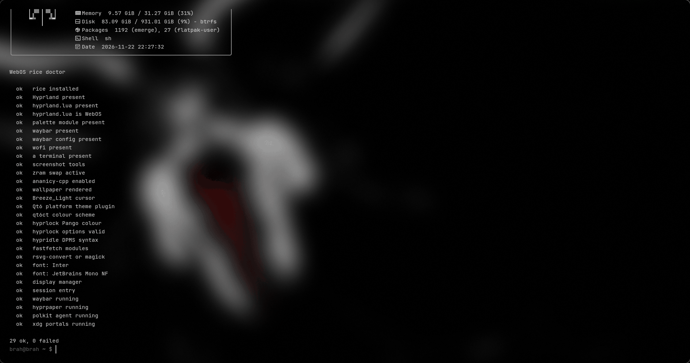
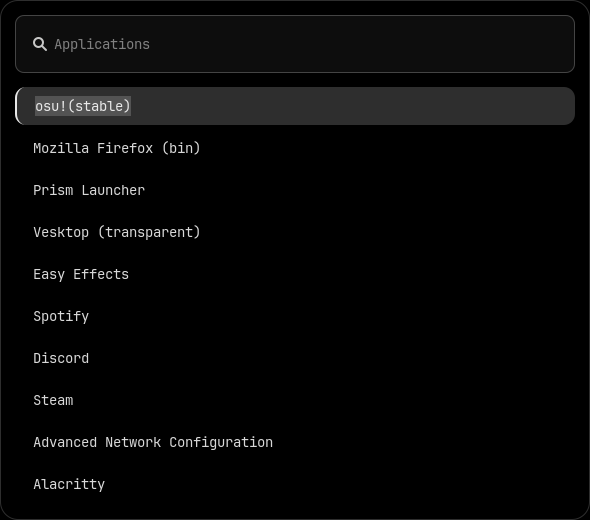

<p align="center">
  
</p>

# WebOS

A lightweight, source-built gaming operating system based on **Gentoo** (OpenRC), with its own kernel, installer, and Deep Black desktop experience for **Hyprland** and **regular Plasma**.

| | |
|---|---|
| **Version** | 1.03 (Ashen) |
| **Base** | Gentoo (OpenRC + elogind, WebOS overlay/profile) |
| **Kernel** | `sys-kernel/webos-kernel` — vanilla LTS + gaming-oriented tuning, `-webos` localversion |
| **Init** | OpenRC (default) |
| **Desktops** | Hyprland with the monochrome rice (default); regular Plasma (Wayland) is an opt-in profile |
| **Installer** | `webos-installer` — custom Rust TUI/GUI wizard with session profiles and feature/app customization |
| **Filesystem** | btrfs (default, subvolumes), ext4, xfs; LUKS2 option |
| **Bootloader** | GRUB2 (BIOS + UEFI) |
| **Arch** | amd64 (64-bit image, `ABI_X86="64"`) |
| **ISO** | `webos-1.03-Ashen-amd64.iso` |

WebOS aims for a fast, gaming-focused desktop with one consistent greyscale look — floating rounded top-bar capsules, near-opaque panels and rounded windows — prebuilt desktop/gaming essentials, and a simple update flow on top of Gentoo/Portage.

## What’s in 1.03

- **Clean rebuild:** built from a fresh stage3 chroot populated only from this repository, so no maintainer accounts, browser profiles, game saves or local overrides are baked into the image. The theme is `webos-theme-1.0-r51` with `webos-theme-1.0-r49` installers still upgradeable via `sudo webos-update`.
- **Hyprland config that actually loads:** Hyprland 0.57 reads `~/.config/hypr/hyprland.lua` and ignores `hyprland.conf`. The rice is now a Lua config plus a `webos-colors.lua` palette module, with `~/.config/hypr/local.lua` loaded for personal tweaks.
- **Session reliability:** SDDM shows exactly the one session chosen in the installer (WebOS or regular Plasma), seeded in `/var/lib/sddm/state.conf`. Portals and a polkit agent start from `webos-portals` on OpenRC; `webos-session` applies the rice before launch; waybar and fastfetch have system-wide fallbacks and reliable autostart.
- **One look, no appearance page:** the refined Ashen greyscale rice — floating rounded top-bar capsules on a near-opaque bar, rounded windows — is the only WebOS appearance and is applied to every install. `webos-dotfiles` remains available for advanced users but the installer no longer asks.
- **Installer:** desktop profile choices are Hyprland, regular Plasma and TTY-only; the chosen session is seeded for the installed user. Plasma comes from the opt-in `@plasma` set and is removed from non-Plasma installs. The progress panel lists finished stages at 100%, shows the real stage count, and no helper command can paint over the TUI.
- **Fixes:** repaired `webos-theme` merge collisions that could leave an ISO without `webos-shell`, waybar config, portal prefs or dark-mode defaults; portal overrides live under `/etc/xdg-desktop-portal`.
- **Settings/devices:** `webos-settings` launcher; under Hyprland use `wdisplays` and compositor device tools (KDE device panels require a Plasma session).
- **Branding & theme:** soft-white spiderweb WebOS logo and WebOS identity (no Gentoo welcome/identity leaks). Refined Ashen greyscale parity across Hyprland and regular Plasma (#000000 base, #D8D8D8 text, #E8E8E8 accents, #7A7A7A dim); translucent kitty (opacity 0.82, `auto` fonts) with a chafa-symbol cobweb fastfetch card, and `Super+Shift+S` screenshot snips.
- **Hyprland UI:** near-opaque top bar (waybar) — left: clickable workspace boxes and window title; centre: mpris pill (icon, title and artist only — no stuck track time, no playlist name) that follows Spotify first and then BetterSoundCloud, and toggles the music dropdown; right: ▧ waypaper, ⟳ update badge, clock, tray, ▾ performance, ⏻ power. `webos-menu` backs Super+D / Super+R, Super+M toggles a compact 340×340 music card with lightly frosted cover art, a spinning vinyl whose centre label is the current cover, bold pure black/white title/artist at the top left, an elapsed/total progress bar with borderless playback buttons directly beneath it, and a slim flat vertical volume bar on the right edge. `webos-stats` opens the corner performance panel. Both dropdowns dismiss on outside click.
- **Updates & packaging:** updates are not automatic — run `sudo webos-update` yourself when the Waybar badge appears. `webos-update` handles sync/@world/depclean/config/kernel+GRUB/flatpak/rice. Gentoo x86-64-v3 binpkgs are used by default via `--getbinpkg`, with `--fast`, `--strict-use`, `--buildpkg` and `--no-compile` controls; third-party overlays ship in the image so @world stays resolvable.

> **Plasma & X11:** regular Plasma 6.8.3 in this image is **Wayland-only** (`startplasma-wayland`, no `startplasma-x11` / Plasma X11 session). X11 Plasma is not available in 1.03 without adding X11 session packages.

## Colourways (dynamic accents)

The Deep Black base and grey text ramp never change, so CJK glyphs and kaomoji stay readable on every wallpaper. Only accents follow the colourway:

- **Automatic:** waypaper runs `webos-accent "$wallpaper"` after each wallpaper change. It extracts a bright, saturated colour and retints Hyprland borders, waybar, GTK 3/4, kitty, wofi and Spicetify.
- **Signature crimson:** `webos-accent --apply /usr/share/webos/colourways/webos-crimson.json`
- **Any colour:** `webos-accent --apply '#ee0001'`
- **Back to Ashen soft-white:** `webos-accent --reset`

Presets live in `overlay/webos-theme/webos-theme/files/colourways/` and install to `/usr/share/webos/colourways/`.

## Recent desktop implementations (theme r41–r51)

- **Spinning vinyl:** a rotating vinyl record drawn in GTK/Cairo has grooves, a fixed light reflection and the current cover as the centre label. It spins only while Spotify plays, and the cover is treated as the label rather than the whole card background.
- **High-contrast everything:** `art_is_light()` drives pure white or black text, buttons, the seek bar and the volume bar. On dark art they are plain white; on light art they are plain black. No glows, outlines or button boxes, so nothing blends into the cover. Artwork detection never blocks the GTK thread.
- **Faster track changes:** the card polls Spotify once every 250 ms with a single `playerctl` metadata call, and prepares artwork in a background thread. The name and cover appear much sooner without disturbing the animation.
- **Waybar time removed:** the MPRIS pill's `{dynamic}` lists only title and artist, so the static track length/position that never moved is gone. The card keeps its elapsed/total labels and seek bar.
- **Cleaner layout:** the title and artist are bold and slightly larger at the top left, the mute button is gone, and flat playback buttons sit directly under the progress bar. The volume control is a slim, flat vertical bar on the right edge; dragging it up raises Spotify-only volume and down lowers it, applied live while dragging. No system sink is touched.
- **Smoother interaction:** dragging the seek bar only previews it; on release Spotify seeks to that point and playback continues from there without the bar snapping back. Volume changes are applied continuously during the drag (up = louder, down = quieter), without touching the system sink.
- **Long titles:** a title too wide for the card wraps onto a second line instead of being cut off.
- **Centred music pill:** the Spotify MPRIS pill sits alone at the centre of the top bar and shows only icon, title and artist. No audio visualizer is installed.
- **Cleaner updater:** retired Vesktop entries are removed from custom Portage sets as well as `world`, so `@world` stops reinstalling it and the update badge clears after a successful run.
- **Packaging:** these changes ship in `webos-theme-1.0-r51`; theme r46 also added animation to floating window toggles.

## Screenshots

| Terminal | Top bar |
|---|---|
|  |  |

| Music card | Music over wallpaper |
|---|---|
|  |  |

| Performance | Launcher |
|---|---|
|  |  |

## Key features

- **Two desktop experiences:** Hyprland (Wayland) by default, with regular Plasma available through the opt-in profile.
- **Gaming-oriented stack:** gamescope, gamemode, MangoHud, vkBasalt, vkd3d-proton, Lutris, Heroic, PipeWire/WirePlumber, Vulkan/Mesa tooling (and NVIDIA driver support option).
- **Prebuilt essentials:** Firefox, Discord, OpenCode, Spotify, BetterSoundCloud (ad-free SoundCloud client), Dolphin, kitty, waybar, wofi, mako, mpv/imv and more (no compile during install for included apps).
- **Music everywhere:** the Super+M card and vinyl show Spotify first, then fall back to BetterSoundCloud tracks through a small bundled bridge; BetterSoundCloud itself ships a matching black/JetBrains Mono WebOS theme with Discord-level compositor transparency.
- **WebOS tooling:** `webos-installer`, `webos-update`, `webos-rice`, `webos-fastfetch`, `webos-shell`, `webos-session`, `webos-wallpaper`, `webos-shot`, `webos-gaming`, `webos-plasma-setup`, `webos-settings`.

## Install

Download the latest release ISO (split parts + checksums): **[Releases](https://github.com/4NT1K/WebOS/releases)**

Reassemble and verify (Linux/macOS):
```bash
cat webos-1.03-Ashen-amd64.iso.part-* > webos-1.03-Ashen-amd64.iso
sha256sum -c SHA256SUMS.txt
```

Windows (PowerShell/CMD):
```bat
copy /b webos-1.03-Ashen-amd64.iso.part-* webos-1.03-Ashen-amd64.iso
```

Flash with Ventoy, Rufus, balenaEtcher, or `dd` (UEFI supported). Boot the live medium and run:
```bash
webos-installer
```

Unattended install:
```bash
webos-installer -c /etc/webos/install.toml -y
```

## Package management & updates

WebOS uses **Portage** (Gentoo) and **OpenRC**. The Gentoo **x86-64-v3 binhost is configured by default** with source fallback: `emerge` prefers matching prebuilt binaries and builds from source when a binary does not match.

```bash
sudo emerge --sync
sudo emerge -av <package>
sudo emerge -avuDN @world
```

One-command updater:
```bash
sudo webos-update           # sync, update world, depclean, config updates, flatpak, rice
sudo webos-update --check   # dry run
```

- Enabled repos in image config: `gentoo`, `webos` (local overlay), and the three third-party overlays (`guru`, `hyproverlay`, `steam-overlay`), which ship in the image and stay enabled on installed systems.
- See installed docs: `/usr/share/webos/WEBOS-INFO.txt`

## Steam / 32-bit note

This image is **64-bit only** (no multilib runtime shipped). Native 32-bit Steam/Wine stacks are not included yet.
- **Flatpak Steam** works (kernel has 32-bit emulation). Flatpak and Flathub are preinstalled, so just install `com.valvesoftware.Steam`.
- Distrobox is another option.
- Native multilib/Steam support is on the roadmap.

## Repository layout

```text
WebOS/
├── build.sh                  # build entry point
├── config/                   # Portage config, repos, sets, profile bits
├── kernel/                   # kernel config/patchset
├── overlay/                  # WebOS Gentoo overlay (ebuilds, theme/rice, tools)
├── installer/                # Rust installer (webos-installer)
├── livecd/                   # live-medium overlay
├── branding/                 # os-release, logos, version, issue
├── scripts/                  # build pipeline stages (00-fetch … 50-check)
└── docs/                     # build/architecture/release docs
```

## Building (from source)

WebOS is built on a Gentoo-capable host with the required tools and disk space.

```bash
git clone https://github.com/4NT1K/WebOS && cd WebOS
sudo ./build.sh fetch      # stage3, snapshots, overlays, patchset, vendor deps
sudo ./build.sh bootstrap  # unpack/apply config/base system
sudo ./build.sh kernel     # build webos-kernel
sudo ./build.sh rootfs     # emerge sets, installer, rice, branding
sudo ./build.sh iso        # squashfs/initramfs/GRUB hybrid ISO
# or
sudo ./build.sh all
```

Output: `build/webos-1.03-Ashen-amd64.iso`

See [`docs/BUILD.md`](docs/BUILD.md), [`docs/ARCHITECTURE.md`](docs/ARCHITECTURE.md), and [`docs/RELEASE.md`](docs/RELEASE.md) for details. If you are maintaining WebOS or pushing out updates, start with [`docs/MAINTENANCE.txt`](docs/MAINTENANCE.txt).

## Design rules

1. **Everything is an ebuild where practical.** System components and theme are packaged in the overlay.
2. **No silent patching.** Kernel patch sources/hashes are tracked and verified.
3. **The rice is a package.** `webos-theme`/`webos-rice` can re-apply the look idempotently.
4. **Installer installs the built system.** The live/install flow uses the produced rootfs + your choices.

## Roadmap

Planned work beyond 1.03 is tracked in [`ROADMAP.md`](ROADMAP.md) (multilib/native Steam, encryption/install UX improvements, handheld support, richer UI shell experiments, etc.).

## License

MIT for the build system, installer, rice and docs (where applicable). Ebuilds follow Gentoo conventions (typically GPL-2.0). See [`LICENSE`](LICENSE).
